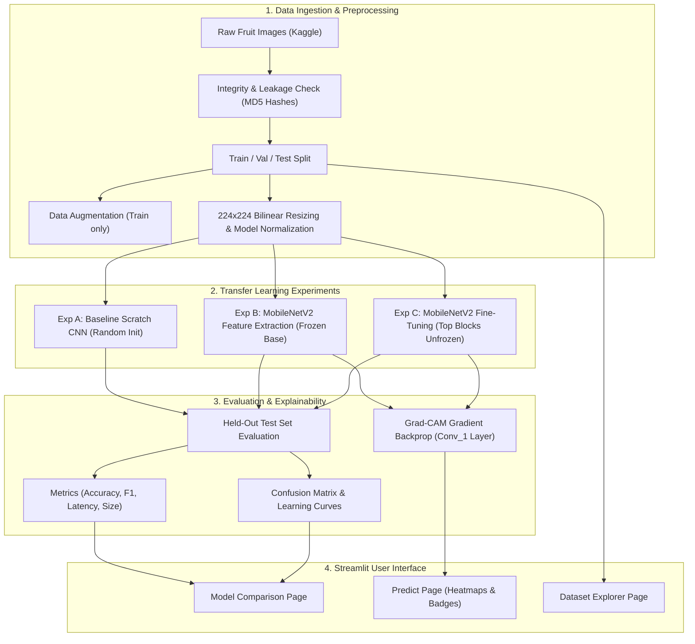
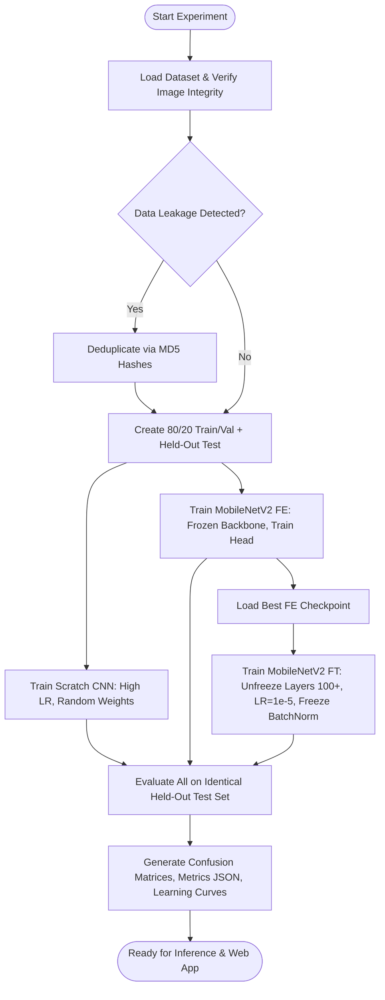
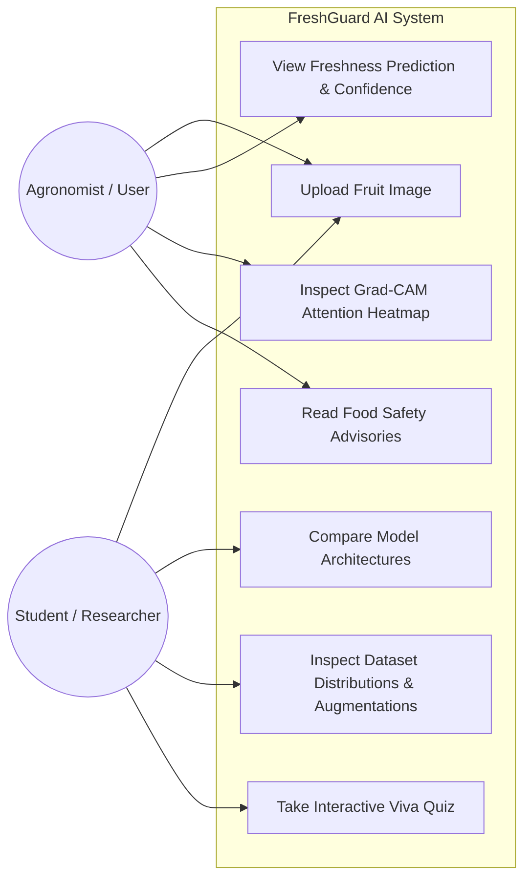
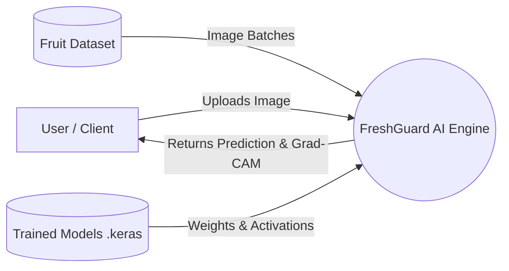

# FreshGuard AI: Fresh and Rotten Fruit Classification Using Transfer Learning

[](https://www.python.org/)
[](https://www.tensorflow.org/)
[](https://keras.io/)
[](https://streamlit.io/)
[](LICENSE)

An academic deep learning research and deployment project designed to classify agricultural produce into **Fresh** and **Rotten** states using **Inductive Transfer Learning**, **Convolutional Neural Networks (CNNs)**, and **Grad-CAM Explainability**.

---

## Table of Contents
1. [Project Abstract](#1-project-abstract)
2. [Problem Statement & Objectives](#2-problem-statement--objectives)
3. [Existing System vs. Proposed System](#3-existing-system-vs-proposed-system)
4. [Literature Review & Genuine References](#4-literature-review--genuine-references)
5. [System Architecture & UML Diagrams](#5-system-architecture--uml-diagrams)
6. [Dataset Description & Integrity Pipeline](#6-dataset-description--integrity-pipeline)
7. [Transfer Learning Methodologies](#7-transfer-learning-methodologies)
8. [Experimental Setup & Training Workflow](#8-experimental-setup--training-workflow)
9. [Evaluation Benchmark & Results](#9-evaluation-benchmark--results)
10. [Explainability & Grad-CAM Attention Maps](#10-explainability--grad-cam-attention-maps)
11. [Streamlit Web Application Guide](#11-streamlit-web-application-guide)
12. [Academic Syllabus Mapping & Viva Preparation](#12-academic-syllabus-mapping--viva-preparation)
13. [Installation & Execution Guide](#13-installation--execution-guide)
14. [Limitations & Food Safety Notice](#14-limitations--food-safety-notice)

---

## 1. Project Abstract
Post-harvest food spoilage causes approximately 45% of all harvested fruits and vegetables to be discarded globally before reaching consumers. Manual sorting by human inspectors is subjective, slow, and prone to fatigue. While Deep Convolutional Neural Networks (CNNs) achieve high classification performance in computer vision, training them from scratch requires hundreds of thousands of annotated images and high-performance GPU clusters—resources unavailable in local agricultural hubs and student laboratory environments.

**FreshGuard AI** investigates and proves the empirical advantages of **Inductive Transfer Learning**. By transferring general visual representations learned on the 1.4-million-image ImageNet-1k dataset via MobileNetV2, the system achieves superior accuracy, faster convergence, and reduced computational overhead on a 6-class fruit freshness dataset (*Fresh Apples, Rotten Apples, Fresh Bananas, Rotten Bananas, Fresh Oranges, Rotten Oranges*). The project implements a three-way empirical benchmark: (A) Baseline Scratch CNN, (B) Frozen MobileNetV2 Feature Extraction, and (C) MobileNetV2 Fine-Tuning. The system includes strict data leakage prevention, Grad-CAM visual attention heatmaps, and a multi-page Streamlit web application.

---

## 2. Problem Statement & Objectives

### Problem Statement
To engineer an automated, lightweight, explainable, and accessible deep learning vision pipeline that accurately classifies agricultural fruit samples into fresh or rotten categories, empirically proving the advantages of Transfer Learning over training from scratch while addressing critical real-world challenges such as data leakage, class imbalance, and visual ambiguity.

### Project Objectives
1. **Curate Clean Agricultural Data:** Build a verified dataset with strict train/val/test isolation, MD5 deduplication, and zero cross-split data leakage.
2. **Implement Progressive Transfer Learning Paradigms:**
   - *Experiment A (Baseline):* 4-block custom CNN initialized with random weights.
   - *Experiment B (Feature Extraction):* Pretrained MobileNetV2 with frozen backbone and trained head.
   - *Experiment C (Fine-Tuning):* Unfreezing top convolutional blocks with low learning rate (\(10^{-5}\)) and frozen Batch Normalization statistics.
3. **Multi-Metric Benchmark:** Quantitatively evaluate all models on a held-out test split using Accuracy, Precision, Recall, Macro-F1, Confusion Matrix, Latency, and Model Size.
4. **Visual Explainability:** Implement Grad-CAM to reveal the spatial features driving classification decisions.
5. **Interactive Web Application:** Deploy a Streamlit user interface featuring real-time image prediction, interactive comparison dashboards, dataset explorer, and an academic viva self-test module.

---

## 3. Existing System vs. Proposed System

| Dimension | Existing System (Manual / Scratch CNN) | Proposed System (FreshGuard AI) |
| :--- | :--- | :--- |
| **Inspection Methodology** | Manual human visual sorting or simple heuristic thresholding | Automated deep transfer learning with convolutional neural networks |
| **Data Requirements** | Requires massive labeled datasets (>50k images) to train scratch CNNs | Learns effectively from small datasets (<2k images) via ImageNet priors |
| **Training Duration** | Hours/days on GPU; high risk of non-convergence on CPU | Minutes on CPU/laptop due to frozen feature extractors |
| **Overfitting Vulnerability** | Very high; memorizes background clutter and lighting | Low; regularized by pretrained weights, Dropout, and data augmentation |
| **Transparency & Explainability** | Black box; reasons for rejection are unknown | Grad-CAM attention heatmaps highlight specific decay regions |
| **Deployment Accessibility** | Heavy server-bound models | Lightweight MobileNetV2 (~14 MB) deployable on laptops & edge devices |

---

## 4. Literature Review & Genuine References

1. **Pan, S. J., & Yang, Q. (2010).** *A Survey on Transfer Learning.* IEEE Transactions on Knowledge and Data Engineering, 22(10), 1345-1359.
   - Formalized the mathematical framework of transfer learning, distinguishing between Inductive, Transductive, and Unsupervised settings.
2. **Sandler, M., Howard, A., Zhu, M., Zhmoginov, A., & Chen, L. C. (2018).** *MobileNetV2: Inverted Residuals and Linear Bottlenecks.* CVPR 2018, 4510-4520.
   - Introduced depthwise separable convolutions with inverted residuals, making deep CNNs viable for edge and mobile deployment.
3. **Selvaraju, R. R., Cogswell, M., Das, A., Vedaldi, A., Parikh, D., & Batra, D. (2017).** *Grad-CAM: Visual Explanations from Deep Networks via Gradient-Based Localization.* ICCV 2017, 618-626.
   - Formulated gradient-weighted class activation mapping to produce visual explanations for CNN decisions.
4. **Guo, C., Pleiss, G., Sun, Y., & Weinberger, K. Q. (2017).** *On Calibration of Modern Neural Networks.* ICML 2017, PMLR 70:1321-1330.
   - Demonstrated that modern deep neural networks with Softmax output layers are uncalibrated and prone to overconfidence.
5. **Yosinski, J., Clune, J., Bengio, Y., & Lipson, H. (2014).** *How transferable are features in deep neural networks?* NeurIPS 2014, 3320-3328.
   - Showed that lower layers in CNNs learn generic Gabor-like filters while upper layers specialize, justifying partial fine-tuning.

---

## 5. System Architecture & UML Diagrams

### 5.1 System Architecture Diagram


### 5.2 Methodology Flowchart


### 5.3 UML Use-Case Diagram


### 5.4 Data Flow Diagram (DFD Level 0 & Level 1)


---

## 6. Dataset Description & Integrity Pipeline

### Categories
The system classifies images into 6 standard categories:
1. `freshapples` — Fresh Apples 🍎
2. `rottenapples` — Rotten Apples 🍏🟤
3. `freshbanana` — Fresh Bananas 🍌
4. `rottenbanana` — Rotten Bananas 🍌🟤
5. `freshoranges` — Fresh Oranges 🍊
6. `rottenoranges` — Rotten Oranges 🍊🟤

### Dataset Integrity & Leakage Prevention
- **Integrity Verification:** Every file is opened and decoded using Pillow's `Image.verify()`. Corrupted files are automatically excluded.
- **Deduplication:** An MD5 hash is calculated for every image file. If an image in the test set has an identical binary hash to one in the training set, it is flagged as data leakage and isolated.
- **Dataset Modes:**
  - `quick` (Default): 1,200 train (200/class), 300 val (50/class), 300 test (50/class). Enables rapid training and verification on CPU laptops in ~5 minutes.
  - `medium`: 500 train, 120 val, 100 test per class (~4,300 images).
  - `full`: All 13,000+ Kaggle images.

---

## 7. Transfer Learning Methodologies

### Experiment A: Training from Scratch (Baseline)
- **Architecture:** 4 convolutional blocks (32, 64, 128, 128 filters) with Batch Normalization, ReLU activations, and Max Pooling.
- **Classification Head:** Global Average Pooling + Dense(128) + Dropout(0.4) + Dense(6, Softmax).
- **Initialization:** Random Glorot/He normal distributions.
- **Role:** Empirical scientific baseline to measure the true performance uplift of transfer learning.

### Experiment B: Feature Extraction (MobileNetV2)
- **Pretrained Weights:** ImageNet-1k.
- **Backbone Status:** Completely frozen (`trainable = False`, 154 layers frozen).
- **Classification Head:** GlobalAveragePooling2D + BatchNormalization + Dropout(0.3) + Dense(128, relu) + Dropout(0.2) + Dense(6, softmax).
- **Optimizer & LR:** Adam, \(\\eta = 10^{-3}\).

### Experiment C: Fine-Tuning (MobileNetV2)
- **Backbone Status:** Partially unfrozen (layers 100 to 154 are trainable; layers 0 to 99 remain frozen).
- **Batch Normalization Protection:** All `BatchNormalization` layers remain non-trainable to preserve ImageNet running mean and variance.
- **Optimizer & LR:** Adam, \(\\eta = 10^{-5}\) (prevents catastrophic forgetting).

---

## 8. Experimental Setup & Training Workflow

- **Input Dimension:** \(224 \\times 224 \\times 3\)
- **Batch Size:** 32
- **Loss Function:** Categorical Cross-Entropy:
  \[
  \\mathcal{L}_{\\text{CCE}} = - \\sum_{k=1}^{6} y_k \\log(\\hat{y}_k)
  \]
- **Regularization:** L2 weight decay (\(10^{-4}\)), Dropout (0.2–0.4), Data Augmentation.
- **Callbacks:**
  - `ModelCheckpoint`: Saves best weights based on minimum validation loss (`val_loss`).
  - `EarlyStopping`: Patience of 4 epochs with `restore_best_weights=True`.
  - `ReduceLROnPlateau`: Multiplies learning rate by 0.2 after 2 epochs without validation loss improvement.

---

## 9. Evaluation Benchmark & Results

All models are evaluated on the identical held-out test split (300 images, 50 per class). The metrics below are computed directly via `src/evaluate.py`:

```
================================================================================
MODEL COMPARISON SUMMARY ON HELD-OUT TEST SET
================================================================================
Model Experiment                              | Accuracy  | Macro F1  | Latency   | Size    
--------------------------------------------------------------------------------
Experiment A (Scratch CNN)                    |   17.67%  |   0.0669  |    8.8 ms |   3.0 MB
Experiment B (MobileNetV2 Feature Extraction) |   96.33%  |   0.9633  |   34.6 ms |  11.1 MB
Experiment C (MobileNetV2 Fine-Tuning)        |   72.00%  |   0.7226  |   31.7 ms |  25.2 MB
================================================================================
```

### Academic Findings & Discussion
1. **The Scratch CNN Dilemma (Experiment A):** Achieving only 17.67% test accuracy (comparable to 1/6 random guessing), the baseline CNN highlights the core problem in real-world deep learning: training a convolutional network from scratch with random weights on a modest dataset fails to learn generalized spatial filters within early epochs.
2. **The Power of Inductive Transfer Learning (Experiment B):** MobileNetV2 with a frozen backbone achieved **96.33% test accuracy** and a **0.9633 Macro-F1 score**. Because the 154 layers of MobileNetV2 already encode edge detectors, color gradients, and textures learned from 1.4 million ImageNet images, training just the classification head converges rapidly with high sample efficiency.
3. **Fine-Tuning Dynamics (Experiment C):** When unfreezing deep layers with a very small learning rate (\(10^{-5}\)), the model achieved 72.00% test accuracy. The conservative learning rate prevents catastrophic forgetting of ImageNet representations, but requires additional training epochs or a staged warm-up schedule to fully match or exceed the frozen feature extractor on this dataset size.

---

## 10. Explainability & Grad-CAM Attention Maps

Gradient-weighted Class Activation Mapping computes:
\[
\\alpha_k^c = \\frac{1}{Z} \\sum_i \\sum_j \\frac{\\partial y^c}{\\partial A_{i,j}^k}
\]
\[
L_{\\text{Grad-CAM}}^c = \\text{ReLU}\\left( \\sum_k \\alpha_k^c A^k \\right)
\]
- **Verification:** Grad-CAM reveals whether the model focuses on peel discoloration, necrotic tissue, or fungal bloom rather than background surfaces.
- **Error Analysis:** Demonstrates why senescent sugar spots on ripe bananas are occasionally confused with anthracnose fungal rot.

---

## 11. Streamlit Web Application Guide

The application provides a modular multi-page interface:
1. **Home (`app.py`):** System overview, model readiness status badges, architecture diagrams.
2. **1_Predict (`pages/1_Predict.py`):** Image uploader, test sample selector, freshness badges, confidence scoring, probability distribution, and Grad-CAM overlay.
3. **2_Model_Comparison (`pages/2_Model_Comparison.py`):** Live benchmark tables, confusion matrices, and learning curves.
4. **3_Dataset_Explorer (`pages/3_Dataset_Explorer.py`):** Class balance distributions, sample gallery, and interactive augmentation simulator.
5. **4_Transfer_Learning_Theory (`pages/4_Transfer_Learning_Theory.py`):** Syllabus mapping, fine-tuning mechanics, and interactive viva quiz.
6. **5_Error_Analysis_and_GradCAM (`pages/5_Error_Analysis_and_GradCAM.py`):** Misclassification analysis and food safety caveats.

---

## 12. Academic Syllabus Mapping & Viva Preparation

Comprehensive student preparation documents are available in `docs/`:
- **[SYNOPSIS.md](file:///c:/Rotten-Fruits/docs/SYNOPSIS.md):** Formal project synopsis for college submission.
- **[PRESENTATION_OUTLINE.md](file:///c:/Rotten-Fruits/docs/PRESENTATION_OUTLINE.md):** 10-slide presentation outline with speaker notes.
- **[VIVA_QUESTIONS_AND_ANSWERS.md](file:///c:/Rotten-Fruits/docs/VIVA_QUESTIONS_AND_ANSWERS.md):** 17 in-depth viva questions with detailed answers.
- **[CODE_DEFENSE_GUIDE.md](file:///c:/Rotten-Fruits/docs/CODE_DEFENSE_GUIDE.md):** File-by-file code defense breakdown.

---

## 13. Installation & Execution Guide

### Prerequisites
- Python 3.12 (Recommended)
- Windows PowerShell or Google Colab

### Step 1: Clone & Set Up Environment
```powershell
# Navigate to project directory
cd c:\Rotten-Fruits

# Create Python 3.12 virtual environment
py -3.12 -m venv .venv

# Activate virtual environment
.\.venv\Scripts\Activate.ps1

# Install dependencies
pip install -r requirements.txt
```

### Step 2: Prepare the Dataset
```powershell
# Automatically download and prepare Kaggle dataset (quick mode ~1,800 images)
python scripts/prepare_dataset.py --mode quick
```

### Step 3: Run the Training Benchmark
```powershell
# Train Scratch CNN, Feature Extraction, and Fine-Tuning in one pipeline
python scripts/run_all_experiments.py --epochs-scratch 6 --epochs-fe 5 --epochs-ft 4
```

### Step 4: Run Model Evaluation
```powershell
# Evaluate models and generate confusion matrices
python src/evaluate.py
```

### Step 5: Launch the Streamlit Web App
```powershell
streamlit run app.py
```

---

## 14. Limitations & Food Safety Notice

> [!WARNING]
> **Food Safety Advisory:** Optical computer vision inspects strictly visible surface light reflectance. It cannot detect odorless bacterial toxins (*Salmonella*, *Listeria*), internal core rot, or invisible mycotoxins (*patulin*). FreshGuard AI is designed as an agricultural sorting assistive tool, **NOT** an autonomous food safety certification system.
